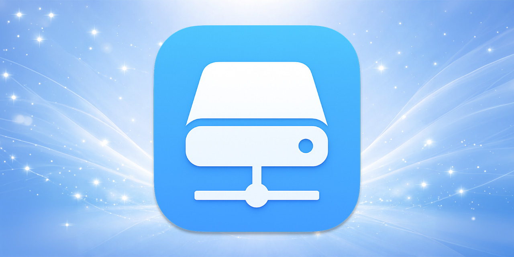
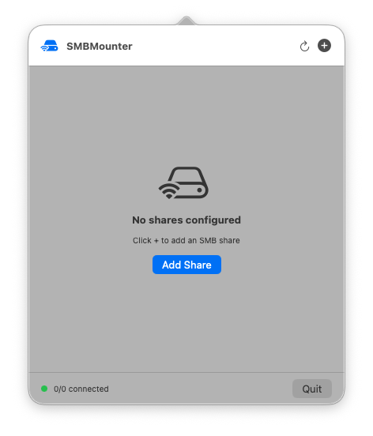
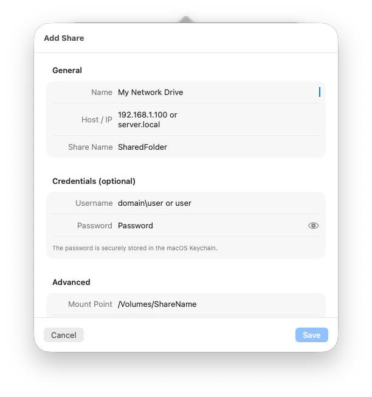
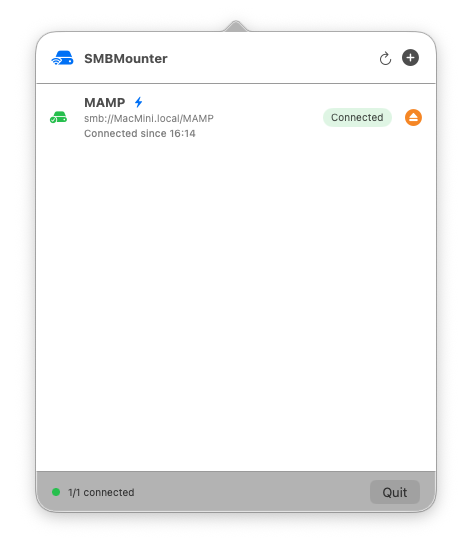

# SMBMounter for macOS

**Automatically mount, reconnect, and manage SMB/WebDAV network drives** – directly from your macOS menu bar.  
Version **1.7** (Build **8**) – developed by **Kevin Tobler** 🌐 [www.kevintobler.ch](https://www.kevintobler.ch)

---

## Network Security

Auto-mount authenticates to the configured server using macOS network services. Bonjour and DNS discovery do not verify server identity. On untrusted networks, disable Auto-Mount or use a trusted VPN and server authentication policies appropriate to your environment. Prefer HTTPS for WebDAV; HTTP does not provide transport encryption. Reconnect timing does not protect against server impersonation.

## 🔄 Changelog

### 🆕 Version 1.x
- **1.7**
  - 🔎 Added manual app update checks from the menu bar settings
  - 🔄 Added optional automatic update checks on every app launch and at daily intervals while the app is running
  - 📥 Available updates open in the browser for manual download and installation
  - 💬 Update dialogs close the menu bar popover and display centered icons and text in a compact layout
  - ℹ️ Added the installed app version to the menu bar view
  - 🌐 Added optional per-share IPv4 CIDR allowlists with multiple networks and add/remove controls
  - 🛡️ Auto-Mount and reconnect now pause when no active local IPv4 address matches an allowed network, or when an enabled policy is empty or invalid
  - 🔎 Network checks include active local interfaces, including VPN, and run again immediately before mounting; one matching address is sufficient
  - ⚠️ Network restrictions do not authenticate the server or guarantee the mount uses the matching interface; another network can reuse the same IP range
  - 🔓 Manual connections outside allowed networks remain possible after explicit confirmation for that attempt
  - 🔄 Saving share settings restarts pending mount attempts with the latest configuration and prevents stale attempts from overwriting the new status
  - ✅ Changing only network restrictions preserves existing mounted connections
- **1.6**
  - 🔒 Prevented AppleScript injection by escaping mount URLs and validating server addresses before mounting (thanks to daveconf for the report)
  - 🔗 Mount URLs now use structured URL components and correctly encode share paths and credentials
  - 🛡️ Mount scripts are now passed through a private input pipe, keeping passwords out of process arguments
  - 🔐 Unified password storage, lookup, and deletion in the macOS Data Protection Keychain, with verified migration of existing login-keychain passwords
  - ⚠️ Added a warning for unencrypted WebDAV HTTP connections and documented server-impersonation risks on untrusted networks
  - 🎯 Disconnect and Open in Finder now use the actual mounted-volume path identified by server and share, fixing incorrect actions on identically named shares
  - ✅ Disconnect now verifies the resulting mount status instead of always marking the share as disconnected
  - 📦 Added Finder automation entitlements and a usage description for hardened-runtime distribution
  - 🧹 Excluded the source Info.plist and entitlements file from bundle resources and removed an ineffective sandbox exception from Info.plist
- **1.5**
  - 🔐 Added support for UPN-style usernames such as `abc@mydomain.local`
  - 🔗 SMB/WebDAV credentials are now percent-encoded correctly when creating Finder mount URLs
  - ↕️ Mount entries can now be reordered via drag and drop, with the chosen order saved automatically
- **1.4**
  - ✅ Fixed mounted-volume detection for shares whose names are substrings of existing volumes
  - 🔎 Mount status checks now compare remount URL host and share path exactly instead of using substring matching
  - 🧭 Shares with the same name on different servers can now be detected independently
- **1.3**
  - ✅ Fixed mounted-volume detection for share names containing spaces, e.g. `Emby Media`
  - 🔎 Mount status checks now handle percent-encoded remount URLs such as `Emby%20Media`
  - 🔐 Improved SMB/WebDAV credential popup handling by allowing longer interactive Finder mount sessions
  - ⚡ Interactive mount sessions now stop early as soon as the share is detected as mounted
- **1.2**
  - 🌐 Added **WebDAV** support alongside SMB
  - 🔐 WebDAV supports **HTTP/HTTPS** selection with automatic default ports
  - 🔌 Added configurable WebDAV port field for custom NAS/server setups
  - 🧭 WebDAV host handling supports plain hosts like `server.local`
  - 🔁 WebDAV connections use the same preflight, mount verification, disconnect, and auto-reconnect flow as SMB
  - 🧰 Improved menu bar icon fallback for menu bar manager compatibility
- **1.1**
  - 🔧 Reworked mount pipeline for higher reliability (clean preflight -> mount -> verify flow)
  - ⏱ Finder mount now runs with hard timeout handling to prevent hanging mount jobs
  - 🧵 Mount attempts are processed sequentially to avoid race conditions between parallel connects
  - 🌐 Improved host resolution with stable SMB reachability checks and Bonjour/local fallback logic
  - 🔁 Added extra retry passes after a failed/disconnected attempt for better wake/reconnect behavior
  - 🛑 Manual disconnect now cancels pending retry/mount flow for that share more consistently
  - 🙈 No more Finder error popups on mount timeout (timeouts are handled silently in-app)
- **1.0**
  - 💾 Auto-mount saved network shares at login  
  - 🔁 Auto-Reconnect after connection loss or sleep/wake events  
  - 🖥️ Modern SwiftUI menu bar interface with status indicators  
  - 🧭 Protocol support: **SMB**
  - ⚙️ Secure Keychain storage for credentials  

---

## 🚀 Features

- 🧠 **Auto-Reconnect** on network loss or after system sleep  
- 🔒 **Keychain Integration** – credentials are stored securely  
- 🌐 **SMB + WebDAV Support** – mount classic SMB shares and WebDAV targets  
- 🔐 **HTTP/HTTPS WebDAV Options** – choose scheme and custom port per connection  
- 💡 **Status Monitoring** – shows mount state in the menu bar  
- 💾 **Auto-Mount at Login** – keep all shares ready automatically  
- 🧩 **SwiftUI Interface** optimized for macOS Sonoma 14.6+ 
- 🌙 **Sleep/Wake Detection** for stable mounts  

---

## 📸 Screenshots

  
  
  

---

## ⚙️ How It Works

1. Add your **network targets** (SMB or WebDAV)  
2. Credentials are stored securely in the **macOS Keychain**   
3. The **menu bar** shows live status for all connections  

---

## 🔧 Installation

1. Download the latest **SMBMounter.app** release  
2. Move **SMBMounter.app** to your **Applications** folder  
3. Launch the app
4. Add your network drives and credentials  
5. Done — your shares will mount automatically!  

> 🧱 Requires macOS 14.6 Sonoma or newer

---

## 🧑‍💻 Developer

**Kevin Tobler**  
🌐 [www.kevintobler.ch](https://www.kevintobler.ch)  
